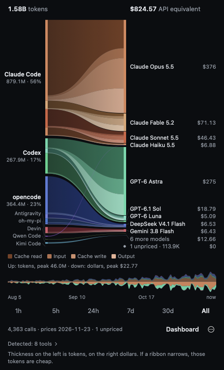
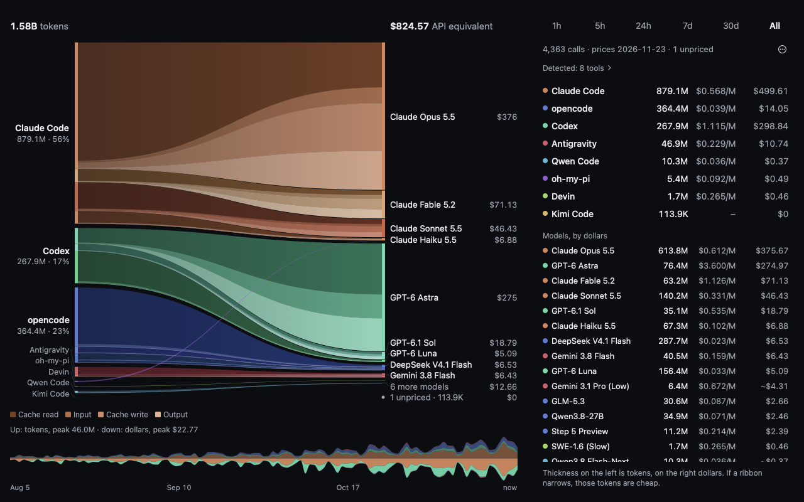

# TokenBar

**English** · [Türkçe](README.tr.md)

TokenBar is a macOS menu bar app (and a Windows tray app, see [Windows](#windows)) that counts the tokens your AI coding tools used, from their local logs, and shows what that usage would cost at API prices.

<p align="center">
  
  
</p>

## Features

- **One picture:** tools on the left, models on the right, one ribbon per tool-model pair. Ribbon width on the left is tokens, on the right is dollars. Both scales are linear, there is no minimum width.
- **Four token kinds** (cache read, input, cache write, output) shown as separate strands inside a ribbon.
- **Time flow** under the picture: tokens up, dollars down, stacked by tool. Hover for the exact slice.
- **Periods:** 1 h, 5 h, 24 h, 7 days, 30 days, All.
- **Detail view** for any ribbon, tool or model: token and dollar share, cache hit rate, unit price, and which price source and slug were used.
- **Dashboard window:** every tool and every model, with the dollars you actually paid per million tokens.
- **Zero config:** detects the AI coding tools on your Mac: 26 are counted and 6 more are listed as detected. See [Supported tools](#supported-tools).
- **Prices stay current:** a built-in price list plus three public catalogues, refreshed from the network at most once a day (and never if you say so). See [How cost is computed](#how-cost-is-computed).
- **Honest gaps:** tools that keep token data on vendor servers are listed as detected, with no invented numbers.
- **English and Turkish** interface, chosen by your system language (override: `TOKENBAR_LANG=en` or `tr`).
- **Local and private:** see [Privacy](#privacy).

## Supported tools

Counted from their local logs: Claude Code, Codex, opencode, oh-my-pi, Qwen Code, Kimi Code, Devin, Antigravity, Crush, Goose, Factory Droid, Amp, OpenHands, Gemini CLI, Pi, GitHub Copilot CLI, Junie, Codebuff, Mistral Vibe, Augment, Cline, Roo Code, Kilo Code, GitHub Copilot Chat, Continue and Zed.

Detected but **not countable**, because they keep token data on the vendor's servers or in logs without token counts: Cursor, Windsurf, Trae, Kiro, Warp and Amazon Q. TokenBar lists them and shows no number.

[docs/HARNESSES.md](docs/HARNESSES.md) has, for every tool, where TokenBar looks, which environment variable moves it, and whether it was verified against real data or written from the tool's file format only. It also shows how to add a tool of your own (`~/.config/tokenbar/custom-sources.json`) and your own price names (`~/.config/tokenbar/model-aliases.json`).

## How cost is computed

The dollar figure is an **API-equivalent cost, not your actual bill.** It answers "what would these tokens cost at list price through the API?", including calls made under a flat subscription.

- A cloud model is priced at its public list price.
- A local model (MLX, Ollama, a quantised copy of a cloud model, ...) is priced at its cloud equivalent if one exists, otherwise at `$0`.
- There is no "free" cloud model: a request routed through a free tier or a free preview is still priced at the model's list price, because the goal is to measure real consumption. A model that is only ever offered for free takes the price of its nearest paid model, and the breakdown says which and why.
- Your own names (a home server, a router chain, a model nobody lists) can be priced in `~/.config/tokenbar/model-aliases.json`; see [docs/HARNESSES.md](docs/HARNESSES.md).
- Tiered pricing (for example above 200k prompt tokens) and cache write/read prices are applied per call.
- A model with no known price shows as "no price" and is counted in the footer; it is never guessed silently.

### Price sources

[OpenRouter](https://openrouter.ai/docs/api-reference/list-available-models), [LiteLLM](https://github.com/BerriAI/litellm) and [models.dev](https://models.dev), plus a small hand-checked table for models none of them lists (a table row copied from OpenRouter gives way to the live OpenRouter row). Every breakdown shows which source and slug priced a model.

- LiteLLM and models.dev (both MIT) ship inside the app as a snapshot, so the first launch already has prices. OpenRouter is read from the network only.
- The app refreshes each catalogue **at most once a day**, at launch and again while it keeps running: one anonymous, static GET per catalogue, with a 24 hour cache and `If-None-Match`, so an unchanged list is not downloaded again. Nothing about you is sent. See [Privacy](#privacy).
- **Offline:** set `TOKENBAR_OFFLINE=1`, or switch on **Offline** in the menu. The app then uses its cached or built-in prices and makes no network call at all. **Update prices** in the same menu refreshes on demand.
- Cached copies live in `~/Library/Caches/TokenBar`.


## Privacy

- TokenBar only **reads** local log files that your tools already wrote. It never modifies them and never uploads them. Its own two optional settings files, `custom-sources.json` and `model-aliases.json`, are yours: the app only reads them.
- The only network traffic is **at most three static GETs per day** (one for each public price catalogue: OpenRouter, LiteLLM, models.dev; 24 h cache, ETag). They carry none of your data. Set `TOKENBAR_OFFLINE=1` to turn even that off.
- **No telemetry, no analytics, no accounts.**

Details: [PRIVACY.md](PRIVACY.md).

## Install

Requirements: macOS 14 or later. Release zips are universal: they run on Apple silicon and Intel Macs.

### Option A: build from source

You need Xcode Command Line Tools (`xcode-select --install`). Also useful: `brew install zstd` (optional, for zstd-compressed logs). The app reads Codex `.jsonl.zst` archives and zstd-compressed Zed threads through that command. Without it, those logs are left unread and the scan names it once ("zstd is missing: brew install zstd"); everything else is counted as usual. The checks run without it too: the ones that need it are skipped, and the output says so.

```bash
git clone https://github.com/dr-ofn/TokenBar.git
cd TokenBar
scripts/build-app.sh --install   # checks + release build + ~/Applications/TokenBar.app + launch
```

`scripts/build-app.sh` alone only builds `dist/TokenBar.app`. `--no-test` skips the checks. `--universal` builds arm64 + x86_64. A copy you build yourself is not downloaded from the internet, so Gatekeeper does not block it.

### Option B: download from Releases

1. Download `TokenBar-VERSION.zip` from [Releases](https://github.com/dr-ofn/TokenBar/releases) and unzip it.
2. Move `TokenBar.app` to `/Applications`.
3. **The first launch is blocked.** TokenBar is not signed with an Apple Developer ID and not notarized (see the [FAQ](#faq)), so macOS Gatekeeper warns about it. To open it anyway, as described by Apple in [Safely open apps on your Mac](https://support.apple.com/en-us/102445):
   1. Try to open TokenBar once, then dismiss the warning.
   2. Open **System Settings > Privacy & Security**, scroll down, and click **Open Anyway** (Turkish macOS: **Yine de Aç**).
   3. Confirm in the prompt that appears (click **Open**). TokenBar is now saved as an exception and opens normally.

   Alternative, from Terminal: remove the quarantine flag that the browser put on the download.

   ```bash
   xattr -dr com.apple.quarantine /Applications/TokenBar.app
   ```

   Apple's page does not describe this command; it clears the download flag that triggers the check. Use either method only if you trust the source. The code is all here, and each release publishes a `.sha256` file so you can verify the zip.

### Option C: Homebrew (own tap)

```bash
brew install --cask dr-ofn/tap/tokenbar
```

This uses a tap in the repository `dr-ofn/homebrew-tap`. Homebrew 6 and later requires you to trust a third-party tap; installing the fully qualified name, as above, trusts just this cask. The cask installs the same unsigned app, so the Gatekeeper steps of Option B still apply on first launch. Homebrew deprecated its `--no-quarantine` flag in 5.0.0, so there is no flag to skip them.

## Windows

TokenBar also runs on Windows 10 and 11 as a system tray app: the same tools, the same price rules and the same totals (checked against the Mac app on a made-up home folder), read-only and local. Download `TokenBar-Windows-<version>.zip` from [Releases](https://github.com/dr-ofn/TokenBar/releases), unzip it and start `TokenBar.exe`. The build is not code-signed, so Windows SmartScreen asks once: **More info → Run anyway**. Details, the Windows folder of every tool and what could not be verified: [windows/README.md](windows/README.md) and [windows/docs/HARNESSES.md](windows/docs/HARNESSES.md).

## Keyboard shortcuts

| Keys | Action |
|---|---|
| ⌘1 ... ⌘6 | Period: 1 h, 5 h, 24 h, 7 days, 30 days, All |
| ⌘D | Open the dashboard |

## Command line

```bash
swift run -c release tokenbar-cli --window all --json
```

`--window` takes `1h`, `5h`, `24h`, `7d`, `30d` or `all`. Without `--json` it prints a text report. `--offline` never touches the network and `--prices-now` fetches the price catalogues now (`--refresh-prices` is the same flag). `tokenbar-cli --help` lists the rest. After `swift build -c release` the binary is `.build/release/tokenbar-cli`.

`TOKENBAR_OPEN=dashboard` opens the dashboard when the app launches.

## Development

```bash
scripts/check.sh                 # build, TokenChecks, CLI vs oracle on a made-up home, UI invariants
swift run UISnapshot all         # renders panel and dashboard to /tmp/tokenbar-*.tiff
python3 scripts/oracle.py all    # independent Python count of the same logs
scripts/release.sh VERSION --universal   # check + build + zip + checksum + release notes (uploads nothing)
```

`scripts/check.sh` also compares against your own logs, so it needs the AI tools' real data on the machine. CI runs the made-up-home part only.

```
Sources/LocalCore       engine: scanner, parsers, store, report, pricing
Sources/TokenBarUI      SwiftUI: ribbons, icon, time flow, breakdown, panel, dashboard
Sources/TokenBar        app entry point
Sources/tokenbar-cli    command-line report
Sources/TokenChecks     data checks (made-up home)
Sources/UISnapshot      UI invariants and screenshots
scripts/                build-app.sh, check.sh, release.sh, oracle.py, update-prices.py
```

### Adding a tool

A new tool is a catalog entry, a made-up home fixture, and a matching reader in `scripts/oracle.py`. See [CONTRIBUTING.md](CONTRIBUTING.md).

## FAQ

**Why is the app unsigned?**
Signing with a Developer ID and notarizing needs a paid Apple Developer Program membership, and this project does not have one. The code is open, so you can build it yourself (Option A), which avoids the warning entirely. Releases are ad-hoc signed only.

**Why isn't Cursor counted?**
Cursor does not store token usage on your Mac: its local `tokenCount` field is `0` and the real numbers live on Cursor's servers. TokenBar lists Cursor as detected and shows no number rather than guessing. The same applies to Windsurf, Trae, Kiro, Warp and Amazon Q. See [docs/HARNESSES.md](docs/HARNESSES.md).

**Why does the cost differ from my bill?**
TokenBar shows an API-equivalent cost at list prices. Your bill can be lower (flat subscriptions, free tiers, committed-use or cache discounts, credits) or higher (taxes, fees, usage TokenBar cannot see). Use it to compare tools and models, not to reconcile an invoice.

**Does it work offline?**
Yes. Without a network it uses its cached or built-in price list. `TOKENBAR_OFFLINE=1` (or **Offline** in the menu) stops the daily price fetch entirely.

## License

[MIT](LICENSE). Contributions are welcome: [CONTRIBUTING.md](CONTRIBUTING.md), [Code of Conduct](CODE_OF_CONDUCT.md).
