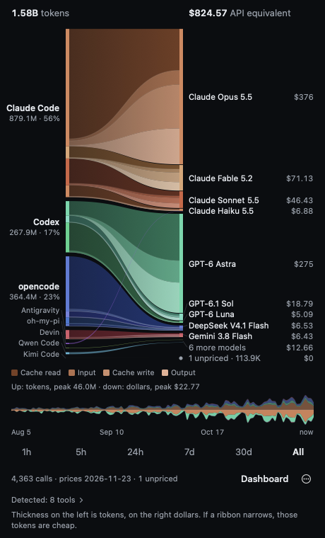
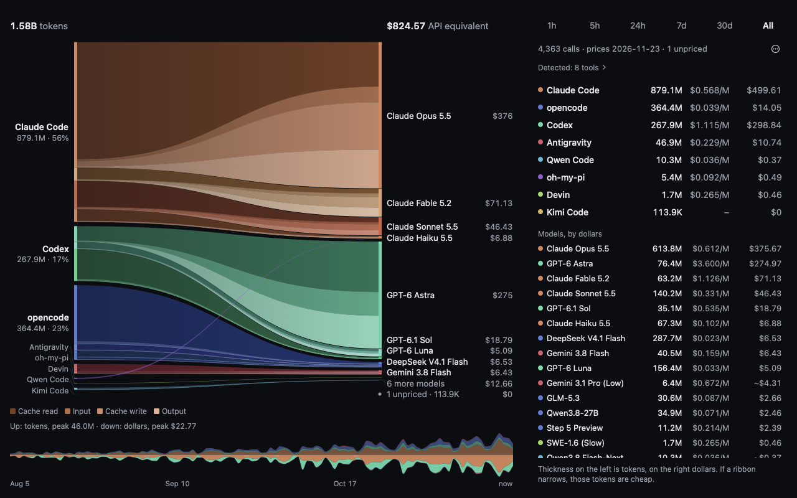

# TokenBar

[English](README.md) · **Türkçe**

TokenBar, yapay zekâ kodlama araçlarının harcadığı token'ları yerel loglarından sayan ve bu kullanımın API fiyatıyla ne tutacağını gösteren bir macOS menü çubuğu uygulamasıdır (Windows'ta sistem tepsisi uygulaması olarak da çalışır, bkz. [Windows](#windows)).

<p align="center">
  
  
</p>

## Özellikler

- **Tek resim:** solda araçlar, sağda modeller, her araç-model çifti için bir şerit. Şeridin soldaki kalınlığı token, sağdaki kalınlığı dolardır. İki ölçek de doğrusaldır, en az kalınlık yoktur.
- **Dört token türü** (cache okuma, giriş, cache yazma, çıktı) şeridin içinde ayrı damar olarak görünür.
- **Zaman akışı** resmin altında: yukarı token, aşağı dolar, araçlara göre istiflenir. Üzerine gelince dilimin tam değeri çıkar.
- **Dönemler:** 1 sa, 5 sa, 24 sa, 7 gün, 30 gün, Tümü.
- **Döküm:** bir şerit, araç ya da model için token ve dolar payı, cache isabeti, birim fiyat, hangi fiyat kaynağı ve slug'ın kullanıldığı.
- **Pano penceresi:** bütün araçlar ve modeller; milyon token başına gerçekten ödenen dolarla.
- **Sıfır ayar:** Mac'indeki yapay zekâ kodlama araçlarını kendisi bulur: 26'sı sayılır, 6'sı daha "algılandı" diye listelenir. Bkz. [Desteklenen araçlar](#desteklenen-araçlar).
- **Fiyatlar güncel kalır:** gömülü bir fiyat listesi ve üç herkese açık katalog; ağdan günde en çok bir kez yenilenir (istemezsen hiç). Bkz. [Maliyet nasıl hesaplanır](#maliyet-nasıl-hesaplanır).
- **Dürüst boşluklar:** token verisini sunucuda tutan araçlar "algılandı" diye listelenir, uydurma sayı yazılmaz.
- **Türkçe ve İngilizce** arayüz, sistem diline göre seçilir (değiştirmek için: `TOKENBAR_LANG=en` ya da `tr`).
- **Yerel ve gizli:** bkz. [Gizlilik](#gizlilik).

## Desteklenen araçlar

Yerel loglarından sayılanlar: Claude Code, Codex, opencode, oh-my-pi, Qwen Code, Kimi Code, Devin, Antigravity, Crush, Goose, Factory Droid, Amp, OpenHands, Gemini CLI, Pi, GitHub Copilot CLI, Junie, Codebuff, Mistral Vibe, Augment, Cline, Roo Code, Kilo Code, GitHub Copilot Chat, Continue ve Zed.

Algılanan ama **sayılamayanlar**, çünkü token verisini üreticinin sunucusunda ya da token sayısı olmayan loglarda tutarlar: Cursor, Windsurf, Trae, Kiro, Warp ve Amazon Q. TokenBar bunları listeler, sayı göstermez.

[docs/HARNESSES.tr.md](docs/HARNESSES.tr.md) her araç için TokenBar'ın nereye baktığını, hangi ortam değişkeninin yeri değiştirdiğini ve gerçek veriyle mi doğrulandığını ya da yalnız aracın dosya biçiminden mi yazıldığını söyler. Kendi aracını (`~/.config/tokenbar/custom-sources.json`) ve kendi fiyat adlarını (`~/.config/tokenbar/model-aliases.json`) nasıl ekleyeceğini de gösterir.

## Maliyet nasıl hesaplanır

Dolar rakamı **API eşdeğeridir, gerçek faturan değildir.** "Bu token'lar API liste fiyatından ne tutardı?" sorusunu yanıtlar; sabit abonelikle yapılan çağrılar dahildir.

- Bulut modeli, herkese açık liste fiyatından hesaplanır.
- Yerel model (MLX, Ollama, bir bulut modelinin kuantize kopyası, ...) bulut karşılığı varsa onun fiyatından, yoksa `$0` ile hesaplanır.
- "Ücretsiz" bir bulut modeli yoktur: ücretsiz katmandan ya da ücretsiz önizlemeden geçen çağrı da modelin liste fiyatından hesaplanır, çünkü amaç gerçek tüketimi ölçmektir. Yalnızca ücretsiz sunulan model en yakın ücretli modelin fiyatını alır; dökümde hangisi olduğu ve nedeni yazar.
- Kendi adlarını (ev sunucusu, yönlendirme zinciri, kimsenin listelemediği bir model) `~/.config/tokenbar/model-aliases.json` ile fiyatlayabilirsin; bkz. [docs/HARNESSES.tr.md](docs/HARNESSES.tr.md).
- Kademeli fiyat (örneğin 200 bin istem token'ı üstü) ve cache yazma/okuma fiyatları çağrı başına uygulanır.
- Fiyatı bilinmeyen model "fiyat yok" görünür ve altta sayılır; sessizce tahmin edilmez.

### Fiyat kaynakları

[OpenRouter](https://openrouter.ai/docs/api-reference/list-available-models), [LiteLLM](https://github.com/BerriAI/litellm) ve [models.dev](https://models.dev); bir de hiçbirinin listelemediği modeller için elle denetlenmiş küçük bir tablo (OpenRouter'dan kopyalanmış bir tablo satırı, canlı OpenRouter satırına yol verir). Dökümde her modelin hangi kaynak ve slug'la fiyatlandığı yazar.

- LiteLLM ve models.dev (ikisi de MIT) uygulamanın içinde anlık görüntü olarak gelir; ilk açılışta fiyatlar hazırdır. OpenRouter yalnızca ağdan okunur.
- Uygulama her kataloğu **günde en çok bir kez** yeniler, açılışta ve açık kaldığı sürece: katalog başına anonim, statik bir GET; 24 saat önbellek ve `If-None-Match` ile, değişmeyen liste yeniden indirilmez. Senin hakkında hiçbir şey gönderilmez. Bkz. [Gizlilik](#gizlilik).
- **Çevrimdışı:** `TOKENBAR_OFFLINE=1` ver ya da menüde **Çevrimdışı**'nı aç. Uygulama önbellekteki ya da gömülü fiyatları kullanır, hiç ağ çağrısı yapmaz. Aynı menüdeki **Fiyatları güncelle** istediğin an yeniler.
- Önbellek kopyaları `~/Library/Caches/TokenBar` içindedir.


## Gizlilik

- TokenBar yalnızca araçlarının zaten yazdığı yerel log dosyalarını **okur**. Onları değiştirmez, hiçbir yere yüklemez. İsteğe bağlı iki ayar dosyası, `custom-sources.json` ve `model-aliases.json`, senindir: uygulama onları yalnızca okur.
- Tek ağ trafiği, herkese açık fiyat katalogları için **günde en çok üç statik GET**'tir (her katalog için bir tane: OpenRouter, LiteLLM, models.dev; 24 saat önbellek, ETag). Bu istekler verinden hiçbirini taşımaz. `TOKENBAR_OFFLINE=1` ile bu da kapanır.
- **Telemetri, analitik, hesap yok.**

Ayrıntı: [PRIVACY.md](PRIVACY.md) (İngilizce).

## Kurulum

Gereksinim: macOS 14 ya da üstü. Release zip'leri evrenseldir: Apple silicon ve Intel Mac'lerde çalışır.

### A: Kaynaktan derle

Xcode Command Line Tools gerekir (`xcode-select --install`). Ayrıca: `brew install zstd` (optional, for zstd-compressed logs; isteğe bağlı, zstd ile sıkıştırılmış loglar için). Uygulama Codex `.jsonl.zst` arşivlerini ve sıkıştırılmış Zed konuşmalarını bu komutla okur. Yoksa o loglar okunmadan bırakılır ve tarama bunu bir kez adıyla yazar ("zstd yok: brew install zstd"); gerisi her zamanki gibi sayılır. Kontroller de onsuz çalışır: ona ihtiyaç duyanlar atlanır ve çıktı bunu söyler.

```bash
git clone https://github.com/dr-ofn/TokenBar.git
cd TokenBar
scripts/build-app.sh --install   # kontroller + release derleme + ~/Applications/TokenBar.app + başlat
```

`scripts/build-app.sh` tek başına yalnızca `dist/TokenBar.app` üretir. `--no-test` kontrolleri atlar. `--universal` arm64 + x86_64 derler. Kendi derlediğin kopya internetten indirilmediği için Gatekeeper engellemez.

### B: Releases'ten indir

1. [Releases](https://github.com/dr-ofn/TokenBar/releases) sayfasından `TokenBar-SÜRÜM.zip` dosyasını indir ve aç.
2. `TokenBar.app`'i `/Applications` içine taşı.
3. **İlk açılış engellenir.** TokenBar bir Apple Developer ID ile imzalı ve noter onaylı değildir (bkz. [SSS](#sss)), bu yüzden macOS Gatekeeper uyarır. Yine de açmak için, Apple'ın [Safely open apps on your Mac](https://support.apple.com/en-us/102445) sayfasındaki gibi:
   1. TokenBar'ı bir kez açmayı dene, uyarıyı kapat.
   2. **Sistem Ayarları > Gizlilik ve Güvenlik**'i aç, aşağı kaydır, **Yine de Aç** (İngilizce macOS: **Open Anyway**) düğmesine bas.
   3. Çıkan onayda **Aç**'a bas. TokenBar istisna olarak kaydedilir ve bundan sonra normal açılır.

   Alternatif, Terminal'den: tarayıcının indirmeye koyduğu karantina bayrağını sil.

   ```bash
   xattr -dr com.apple.quarantine /Applications/TokenBar.app
   ```

   Apple'ın sayfası bu komutu anlatmaz; denetimi tetikleyen indirme bayrağını temizler. İkisini de yalnızca kaynağa güveniyorsan kullan. Kodun tamamı burada, her sürümle birlikte zip'i doğrulaman için bir `.sha256` dosyası yayımlanır.

### C: Homebrew (kendi tap'imiz)

```bash
brew install --cask dr-ofn/tap/tokenbar
```

Bu, `dr-ofn/homebrew-tap` deposundaki bir tap'i kullanır. Homebrew 6 ve sonrası üçüncü taraf tap'ine güvenmeni ister; yukarıdaki gibi tam adla kurmak yalnızca bu cask'e güvenmiş olur. Cask aynı imzasız uygulamayı kurar, bu yüzden ilk açılışta B seçeneğindeki Gatekeeper adımları geçerlidir. Homebrew `--no-quarantine` bayrağını 5.0.0'da kullanımdan kaldırdı, bu adımları atlatan bir bayrak yok.

## Windows

TokenBar Windows 10 ve 11'de sistem tepsisi uygulaması olarak da çalışır: aynı araçlar, aynı fiyat kuralları ve aynı toplamlar (kurmaca bir ev klasöründe Mac uygulamasıyla karşılaştırıldı), salt okunur ve yerel. [Releases](https://github.com/dr-ofn/TokenBar/releases) sayfasından `TokenBar-Windows-<sürüm>.zip` dosyasını indirip açın, `TokenBar.exe`'yi başlatın. Uygulama imzasız olduğundan SmartScreen bir kez sorar: **Ek bilgi → Yine de çalıştır**. Ayrıntılar, her aracın Windows klasörü ve doğrulanamayanlar: [windows/README.tr.md](windows/README.tr.md) ve [windows/docs/HARNESSES.md](windows/docs/HARNESSES.md).

## Klavye kısayolları

| Tuşlar | İşlev |
|---|---|
| ⌘1 ... ⌘6 | Dönem: 1 sa, 5 sa, 24 sa, 7 gün, 30 gün, Tümü |
| ⌘D | Panoyu aç |

## Komut satırı

```bash
swift run -c release tokenbar-cli --window all --json
```

`--window` değerleri: `1h`, `5h`, `24h`, `7d`, `30d`, `all`. `--json` olmadan metin raporu basar. `--offline` ağa hiç çıkmaz, `--prices-now` fiyat kataloglarını hemen indirir (`--refresh-prices` aynı bayraktır). Gerisi için `tokenbar-cli --help`. `swift build -c release`'ten sonra ikili dosya `.build/release/tokenbar-cli`'dir.

`TOKENBAR_OPEN=dashboard` uygulama açılırken panoyu da açar.

## Geliştirme

```bash
scripts/check.sh                 # derleme, TokenChecks, kurmaca evde CLI↔oracle, arayüz değişmezleri
swift run UISnapshot all         # paneli ve panoyu /tmp/tokenbar-*.tiff'e çizer
python3 scripts/oracle.py all    # aynı logların Swift'ten bağımsız Python sayımı
scripts/release.sh SÜRÜM --universal   # kontrol + derleme + zip + sağlama + sürüm notları (hiçbir şey yüklemez)
```

`scripts/check.sh` kendi loglarınla da karşılaştırır, bu yüzden makinede araçların gerçek verisi gerekir. CI yalnızca kurmaca ev kısmını koşar.

### Yeni araç ekleme

Yeni bir araç = katalog girdisi, kurmaca ev fixture'ı ve `scripts/oracle.py`'de karşılığı. Bkz. [CONTRIBUTING.md](CONTRIBUTING.md).

## SSS

**Uygulama neden imzasız?**
Developer ID ile imzalamak ve noter onayı almak ücretli Apple Developer Program üyeliği ister; bu projede yok. Kod açık, kendin derleyebilirsin (A seçeneği); uyarı hiç çıkmaz. Sürümler yalnızca ad-hoc imzalıdır.

**Cursor neden sayılmıyor?**
Cursor token kullanımını Mac'inde tutmaz: yerel `tokenCount` alanı `0`'dır, gerçek sayılar Cursor'ın sunucusundadır. TokenBar, tahmin etmek yerine Cursor'ı "algılandı" diye listeler ve sayı göstermez. Aynısı Windsurf, Trae, Kiro, Warp ve Amazon Q için geçerlidir. Bkz. [docs/HARNESSES.tr.md](docs/HARNESSES.tr.md).

**Maliyet neden faturamdan farklı?**
TokenBar liste fiyatlarından API eşdeğerini gösterir. Faturan daha düşük olabilir (sabit abonelik, ücretsiz katman, taahhüt ya da cache indirimi, kredi) ya da daha yüksek (vergi, ücretler, TokenBar'ın göremediği kullanım). Araçları ve modelleri karşılaştırmak için kullan, faturayı kapatmak için değil.

**Çevrimdışı çalışır mı?**
Evet. Ağ yoksa önbellekteki ya da gömülü fiyat listesini kullanır. `TOKENBAR_OFFLINE=1` (ya da menüdeki **Çevrimdışı**) günlük fiyat çekmeyi tümüyle durdurur.

## Lisans

[MIT](LICENSE). Katkılar açık: [CONTRIBUTING.md](CONTRIBUTING.md), [Davranış Kuralları](CODE_OF_CONDUCT.md).
